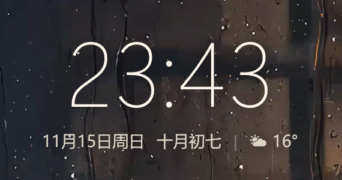
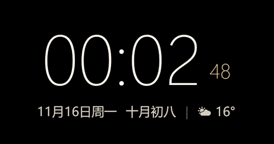

# 此刻 · 桌面时钟（DesktopClock）

> 一个透明背景的 Windows 桌面数字时钟：大号时间 + 日期 + 农历 + 当日天气。
> 零依赖，双击即用 —— 只用 Windows 自带的 .NET / WPF 写成。



<sub>黑色部分是透明区域，实际会直接叠在壁纸上。</sub>



---

## 特性

- **透明浮层**：无窗口边框、无背景板，只有文字浮在壁纸上；文字带柔和阴影，浅色壁纸也清晰。
- **一屏信息**：`HH:mm` 大号时间 + `11月15日周日` + `十月初七`（农历）+ 当天天气符号与温度。
- **轻量**：一个 PowerShell + XAML 脚本，约 700 行；启动快、常驻内存小，不装任何第三方库。
- **顺手**：拖动移动、滚轮调透明度、右键菜单切换外观。
- **三种外观**：透明（默认）/ 深色玻璃 / 浅色玻璃。
- **四档尺寸**、四档不透明度。
- **天气自动定位**：按 IP 定位城市，显示天气符号 + 温度；可手动指定城市。
- **桌面层模式**：可切换「置于底层」，像贴纸一样待在桌面层，不抢焦点。
- **开机自启**：菜单一键写入启动文件夹。
- **单实例**：重复启动不会开出第二个时钟；不出现在任务栏和 Alt+Tab。

## 快速开始

> 不想折腾源码？直接下载 [Releases](https://github.com/xiehuangbaohaochi/desktop-clock/releases) 里的 `DesktopClock-v1.0.0.zip`，解压后双击 `启动时钟.bat` 即可。

1. 下载本仓库（`Code → Download ZIP` 或 `git clone`）。
2. 双击 **`启动时钟.bat`** 即可运行。

想要一个带图标的快捷方式（或顺便开机自启），在本目录执行：

```powershell
powershell -NoProfile -ExecutionPolicy Bypass -File .\Setup.ps1
# 连同开机自启：
# powershell -NoProfile -ExecutionPolicy Bypass -File .\Setup.ps1 -Autostart
```

> 首次运行会在同目录生成 `clock-settings.json`（你的设置）和 `weather-cache.json`（天气缓存）。
> 如果系统提示"无法验证发布者"，选择"仍要运行"即可；脚本内容完全公开、可自行审阅。

也可以直接运行：

```powershell
powershell -NoProfile -STA -ExecutionPolicy Bypass -File .\DesktopClock.ps1
```

## 操作

| 操作 | 效果 |
| --- | --- |
| 左键拖动 | 移动位置（自动记住） |
| 滚轮 | 调整整体不透明度（30%–100%） |
| 右键 | 打开菜单 |

菜单项：

- **显示秒**：在大号时间右侧显示秒数
- **24 小时制**：切换 12 / 24 小时（12 小时制显示"上午/下午"）
- **显示天气**：显示/隐藏天气
- **置于底层**：贴桌面层显示（不置顶、不抢焦点），按 `Win+D` 回桌面即可看到
- **外观主题**：深色玻璃 / 浅色玻璃 / 透明
- **显示尺寸**：小 / 标准 / 大 / 特大
- **不透明度**：100% / 85% / 70% / 55%
- **刷新天气**：立即重新获取
- **开机自动启动**：写入/移除启动文件夹快捷方式
- **回到默认位置**：回到屏幕顶部居中
- **退出**

## 天气

- 数据来自 [wttr.in](https://wttr.in)，无需 API Key，按 IP 自动定位。
- 启动时先显示上次缓存，随后后台刷新，之后每 20 分钟更新一次。
- 想固定城市：编辑 `clock-settings.json`：

```json
{
  "city": "Shanghai"
}
```

> 用英文城市名或拼音，保存后重启时钟生效。

## 自定义

所有外观参数集中在 `DesktopClock.ps1` 顶部的 XAML 里：

- `TimeText` 的 `FontSize` / `FontWeight` 控制时间字号与字重
- `DateText` / `LunarText` / `WeatherText` 控制信息行
- `Themes` 表里改颜色、阴影强度
- `Margin` / `CornerRadius` 控制留白与圆角

改完保存，重启时钟即可生效。

## 项目结构

```
desktop-clock/
├─ DesktopClock.ps1     # 主程序：界面 + 时钟 + 农历 + 天气
├─ 启动时钟.bat          # 双击启动
├─ Setup.ps1            # 生成快捷方式 / 开机自启
├─ clock.ico            # 程序 / 快捷方式图标
├─ clock.png            # 图标源图
├─ preview.png          # 效果预览
├─ README.md
└─ LICENSE
```

运行后会额外生成（已加入 `.gitignore`）：

- `clock-settings.json`：位置、主题、开关等
- `weather-cache.json`：天气缓存
- `clock.log`：出错日志（正常为空）

## 常见问题

**天气不显示？**
需要能访问 `wttr.in`。网络受限时天气区会自动隐藏，其它功能不受影响；可稍后点「刷新天气」。

**开机自启没生效？**
菜单里的开关需要写入启动文件夹的权限。失败时可手动操作：`Win+R` → `shell:startup`，把 `此刻桌面时钟.lnk` 的副本放进去。

**想换个位置 / 尺寸？**
拖动即可；尺寸和透明度都在右键菜单里。

**怎么彻底卸载？**
右键 → 退出，删除本文件夹；如开过自启，再到 `shell:startup` 删掉快捷方式。

## License

[MIT](LICENSE)
